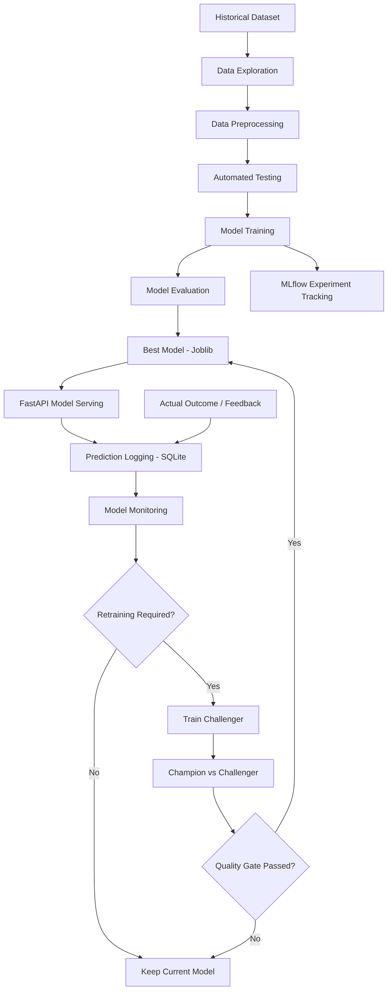
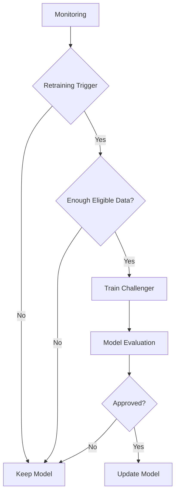

# Online Shopping Purchase Prediction — MLOps Pipeline

Project Machine Learning end-to-end untuk memprediksi kemungkinan pembelian berdasarkan karakteristik dan aktivitas sesi pengunjung website e-commerce.

Project ini mengimplementasikan Machine Learning Operations (MLOps), mulai dari data ingestion, preprocessing, model training, experiment tracking, automated testing, deployment, monitoring, hingga automated retraining dan CI/CD.

---

## 1. Project Objectives

Tujuan project ini adalah:

- Memprediksi apakah pengunjung website akan melakukan pembelian.
- Membandingkan performa beberapa algoritma Machine Learning.
- Membangun pipeline Machine Learning yang terorganisir dan reproducible.
- Menyediakan model melalui REST API untuk real-time inference.
- Mendeteksi perubahan distribusi data dan penurunan performa model.
- Melakukan retraining dan model update berdasarkan hasil monitoring.
- Mengimplementasikan automated testing dan CI/CD.

Project ini relevan dengan SDG 8: Decent Work and Economic Growth, khususnya dalam pemanfaatan teknologi untuk mendukung produktivitas dan pengambilan keputusan bisnis.

## 2. Dataset

Dataset yang digunakan adalah Online Shoppers Purchasing Intention Dataset dari UCI Machine Learning Repository.

- Total data: 12.330 sesi pengunjung.
- Original features: 17.
- Features yang digunakan: 16.
- Target variable: Revenue.
- Missing values pada dataset asli: 0.
- Purchase rate: sekitar 15,47%.

Target prediction:

| Value | Description |
|---|---|
| 0 | Pengunjung tidak melakukan pembelian |
| 1 | Pengunjung melakukan pembelian |

Fitur PageValues tidak digunakan untuk mengurangi risiko data leakage.

Dataset dibagi menggunakan stratified splitting:

| Dataset | Percentage | Total Data |
|---|---:|---:|
| Training | 70% | 8.631 |
| Validation | 15% | 1.849 |
| Testing | 15% | 1.850 |

Dataset source:

https://archive.ics.uci.edu/dataset/468/online+shoppers+purchasing+intention+dataset

Dataset tersedia dengan lisensi CC BY 4.0.

## 3. Technology Stack

| Technology | Purpose |
|---|---|
| Python | Main programming language |
| Pandas | Data processing |
| NumPy | Numerical processing |
| Scikit-learn | Preprocessing, training, dan evaluation |
| MLflow | Experiment tracking |
| Prefect | Workflow orchestration |
| Pytest | Automated testing |
| FastAPI | REST API dan model serving |
| Uvicorn | API server |
| Pydantic | Request validation |
| SQLite | Prediction dan feedback logging |
| SciPy | Data drift detection |
| Joblib | Model serialization |
| Skops | MLflow model serialization |
| GitHub | Version control |
| GitHub Actions | CI/CD |

## 4. System Architecture



Sistem memiliki dua workflow utama yang dikelola menggunakan Prefect:

1. Initial Training Pipeline.
2. Model Maintenance Pipeline.

## 5. Project Structure

```text
ml-ops-pipeline/
├── .github/
│   └── workflows/
│       └── mlops.yml
├── datasets/
│   └── online_shoppers_intention.csv
├── models/
│   └── best_model.joblib
├── outputs/
│   └── monitoring_report.json
├── tests/
│   └── test_pipeline.py
├── explore_data.py
├── preprocess.py
├── train.py
├── main.py
├── api.py
├── simulate_traffic.py
├── monitor.py
├── retrain.py
├── maintenance.py
├── requirements.txt
├── .gitignore
└── README.md
```

Folder models, outputs, database SQLite, dan MLflow artifacts akan dihasilkan secara otomatis ketika sistem dijalankan.

### File Responsibilities

| File | Description |
|---|---|
| explore_data.py | Melakukan Exploratory Data Analysis |
| preprocess.py | Data splitting, encoding, dan scaling |
| train.py | Training, evaluation, model selection, dan MLflow tracking |
| main.py | Initial training pipeline menggunakan Prefect |
| api.py | REST API untuk prediction dan feedback |
| simulate_traffic.py | Simulasi traffic pengunjung menggunakan data historis |
| monitor.py | Data drift, prediction drift, dan performance monitoring |
| retrain.py | Champion–Challenger training dan model update |
| maintenance.py | Monitoring dan retraining pipeline menggunakan Prefect |
| tests/test_pipeline.py | Automated testing |
| mlops.yml | GitHub Actions CI/CD workflow |

## 6. Installation and Setup

### Prerequisites

Pastikan sudah menginstal:

- Python 3.14
- Git
- Visual Studio Code atau code editor lainnya

### Step 1 — Clone Repository

Salin URL repository melalui tombol Code pada GitHub.

```bash
git clone <repository-url>
cd ml-ops-pipeline
```

### Step 2 — Create Virtual Environment

```bash
python -m venv .venv
```

Aktifkan virtual environment.

Windows PowerShell:

```powershell
.\.venv\Scripts\Activate.ps1
```

Windows Command Prompt:

```cmd
.venv\Scripts\activate.bat
```

Linux atau macOS:

```bash
source .venv/bin/activate
```

### Step 3 — Install Dependencies

```bash
python -m pip install -r requirements.txt
```

Pastikan seluruh dependencies berhasil diinstal sebelum melanjutkan.

Seluruh command berikutnya harus dijalankan dari root folder project menggunakan virtual environment yang sama.

## 7. Running the Project

### Step 1 — Start MLflow Server

Buka Terminal 1:

```bash
mlflow server --backend-store-uri sqlite:///mlflow.db --port 5000
```

Buka MLflow Dashboard:

http://127.0.0.1:5000

MLflow digunakan untuk melihat:

- Experiment runs.
- Model parameters.
- Evaluation metrics.
- Model artifacts.
- Retraining results.

Biarkan terminal tetap berjalan.

### Step 2 — Start Prefect Server

Buka Terminal 2:

```bash
prefect server start
```

Buka Prefect Dashboard:

http://127.0.0.1:4200

Pada terminal lain, hubungkan Prefect dengan server lokal:

```bash
prefect config set PREFECT_API_URL="http://127.0.0.1:4200/api"
```

Biarkan Prefect Server tetap berjalan.

### Step 3 — Run Initial Training Pipeline

Buka Terminal 3:

```bash
python main.py
```

Pipeline akan menjalankan:

1. Data exploration.
2. Data preprocessing.
3. Automated testing.
4. Model training.
5. Experiment tracking.
6. Model selection.
7. Model evaluation dan saving sesuai konfigurasi.

Pastikan FINALIZE_MODEL bernilai True pada train.py agar model terbaik disimpan.

Setelah berhasil, model akan tersedia pada:

```text
models/best_model.joblib
```

Periksa hasil eksperimen pada MLflow Dashboard dan status workflow pada Prefect Dashboard.

### Step 4 — Start FastAPI Server

Buka Terminal 4:

```bash
python -m uvicorn api:app --port 8000
```

Swagger API Documentation:

http://127.0.0.1:8000/docs

Health Check:

http://127.0.0.1:8000/health

API dapat berjalan secara mandiri setelah model tersedia, tanpa membutuhkan MLflow dan Prefect untuk setiap request.

## 8. Model Training and Evaluation

Terdapat tiga algoritma yang dibandingkan:

| Model | Purpose |
|---|---|
| Dummy Classifier | Baseline model |
| Logistic Regression | Linear classification model |
| Random Forest | Tree-based ensemble model |

Preprocessing menggunakan:

- StandardScaler untuk numerical features.
- OneHotEncoder untuk categorical features.
- Scikit-learn Pipeline untuk menggabungkan preprocessing dan model.

Evaluation metrics:

- Accuracy.
- Precision.
- Recall.
- F1-score.
- Average Precision (AP).
- Confusion Matrix.

Average Precision digunakan sebagai metrik utama untuk model selection karena dataset memiliki distribusi target yang tidak seimbang.

Model terbaik dipilih berdasarkan validation dataset, bukan testing dataset.

### Training Configuration

Pada train.py terdapat dua konfigurasi:

```python
FINALIZE_MODEL = True

RUN_FINAL_TEST = os.getenv(
    "RUN_FINAL_TEST", "true"
) == "true"
```

| Configuration | Description |
|---|---|
| FINALIZE_MODEL | Mengontrol penyimpanan model terbaik |
| RUN_FINAL_TEST | Mengontrol pelaksanaan final testing |

Final testing sebaiknya tidak digunakan berulang kali untuk menentukan konfigurasi model.

## 9. REST API Documentation

Base URL:

```text
http://127.0.0.1:8000
```

### Available Endpoints

| Method | Endpoint | Description |
|---|---|---|
| GET | /health | Memeriksa status API |
| POST | /predict | Melakukan prediksi pembelian |
| POST | /feedback/{prediction_id} | Menyimpan hasil pembelian aktual |

### POST /predict

Example request body:

```json
{
    "Administrative": 2,
    "Administrative_Duration": 40.5,
    "Informational": 1,
    "Informational_Duration": 25.0,
    "ProductRelated": 25,
    "ProductRelated_Duration": 950.0,
    "BounceRates": 0.01,
    "ExitRates": 0.02,
    "SpecialDay": 0.0,
    "Month": "Nov",
    "OperatingSystems": 2,
    "Browser": 2,
    "Region": 1,
    "TrafficType": 2,
    "VisitorType": "Returning_Visitor",
    "Weekend": true
}
```

Example response:

```json
{
    "prediction_id": 1,
    "prediction": 1,
    "purchase_probability": 0.7852
}
```

Keterangan:

- prediction_id: Identitas prediksi pada database.
- prediction: Hasil klasifikasi pembelian.
- purchase_probability: Estimasi probabilitas pembelian dari model.

Nilai response di atas hanya merupakan contoh.

Setiap prediksi akan disimpan secara otomatis pada monitoring.db.

### POST /feedback/{prediction_id}

Endpoint ini digunakan untuk memberikan ground truth atau hasil pembelian yang sebenarnya.

Example request:

```text
POST /feedback/1
```

Request body:

```json
{
    "actual": 0
}
```

Response:

```json
{
    "message": "Feedback saved successfully"
}
```

Feedback digunakan untuk mengevaluasi performa model setelah deployment.

## 10. Automated Testing

Untuk menjalankan seluruh automated tests:

```bash
python -m pytest tests/ -v
```

Pengujian mencakup:

| Test | Purpose |
|---|---|
| test_dataset | Memastikan dataset valid |
| test_features | Memeriksa kelengkapan fitur dan risiko data leakage |
| test_data_split | Memastikan indeks antar-dataset tidak tumpang tindih |
| test_preprocessing | Memastikan preprocessing berjalan dengan benar |
| test_model | Memastikan model dapat melakukan prediksi |

Automated testing juga dijalankan melalui Prefect sebelum initial model training.

Jika salah satu pengujian gagal, training pipeline akan dihentikan.

## 11. Traffic Simulation

Karena project belum terhubung dengan website e-commerce sungguhan, traffic pengunjung disimulasikan menggunakan data testing historis.

Pastikan FastAPI Server sedang berjalan.

Buka simulate_traffic.py dan tentukan konfigurasi:

```python
SIMULATE_DRIFT = False
```

Jalankan:

```bash
python simulate_traffic.py
```

Simulator akan:

1. Mengambil maksimal 200 sampel pengunjung.
2. Mengirim HTTP request ke endpoint /predict.
3. Menerima hasil prediksi.
4. Mengirim ground truth ke endpoint /feedback.
5. Menghasilkan riwayat prediksi pada SQLite.

### Simulating Data Drift

Untuk menyimulasikan perubahan distribusi pengunjung:

```python
SIMULATE_DRIFT = True
```

Kemudian jalankan kembali:

```bash
python simulate_traffic.py
```

Simulator akan mengambil pengunjung dari bulan November sehingga distribusi data berbeda dari distribusi training awal.

Simulator menghindari penggunaan kembali sampel yang tercatat dalam riwayat retraining. Oleh karena itu, jumlah data yang tersedia dapat berkurang setelah beberapa eksperimen.

## 12. Model Monitoring

Jalankan:

```bash
python monitor.py
```

Monitoring membutuhkan minimal 100 prediksi dari versi model yang sedang digunakan.

Terdapat tiga jenis monitoring:

### Data Drift

Memeriksa perubahan distribusi input model.

Metode yang digunakan:

- Kolmogorov-Smirnov Statistic untuk numerical features.
- Total Variation Distance untuk categorical features.

### Prediction Drift

Memeriksa perubahan distribusi probabilitas prediksi menggunakan Kolmogorov-Smirnov Statistic.

### Model Performance Monitoring

Membandingkan performa model pada validation dataset dengan performa pada data terbaru yang memiliki ground truth.

Metrik yang digunakan:

- Average Precision.
- F1-score.

### Monitoring Thresholds

| Monitoring Type | Threshold |
|---|---:|
| Numerical Data Drift | KS >= 0.20 |
| Categorical Data Drift | TVD >= 0.20 |
| Prediction Drift | KS >= 0.20 |
| Performance Degradation | AP drop >= 0.10 |

Threshold tersebut merupakan kebijakan demonstrasi project, bukan standar universal.

Hasil monitoring disimpan pada:

```text
outputs/monitoring_report.json
```

## 13. Automated Retraining

Retraining menggunakan pendekatan Champion–Challenger.

- Champion: Model yang sedang digunakan.
- Challenger: Model kandidat yang dilatih menggunakan tambahan data terbaru.

Retraining dipertimbangkan apabila:

- Data drift terdeteksi.
- Prediction drift terdeteksi.
- Model performance degradation terdeteksi.

Data baru harus memenuhi persyaratan kualitas sebelum digunakan:

- Minimal 100 data baru yang memenuhi syarat.
- Memiliki ground truth.
- Memiliki kedua kelas target.
- Minimal 10 sampel pada kelas minoritas.
- Tidak menggunakan kembali pola data yang sudah tercatat dalam riwayat retraining.

Data baru dibagi menjadi:

- 70% untuk tambahan training data.
- 30% untuk membandingkan Champion dan Challenger.

Challenger hanya menggantikan Champion apabila:

1. Average Precision pada data evaluasi terbaru meningkat minimal 0.01.
2. Average Precision pada validation dataset lama tidak turun lebih dari 0.02.

Hasil retraining dicatat pada MLflow dalam experiment:

```text
Online Shopping Retraining
```

Jika Challenger tidak memenuhi persyaratan, model sebelumnya tetap digunakan.

### Run Retraining Manually

Pastikan monitoring report sudah tersedia.

```bash
python retrain.py
```

### Run Maintenance Pipeline

Untuk menjalankan monitoring dan retraining melalui Prefect:

```bash
python maintenance.py
```

Maintenance pipeline akan melakukan monitoring terlebih dahulu, kemudian menentukan apakah retraining diperlukan.

Jika model berhasil diperbarui, restart FastAPI Server agar model terbaru digunakan.

Jangan menjalankan ulang main.py setelah retraining kecuali memang ingin membangun kembali model awal, karena file model hasil retraining dapat tertimpa.

## 14. Workflow Orchestration

Project memiliki dua Prefect workflow.

### Initial Training Pipeline


Command:

```bash
python main.py
```

### Maintenance Pipeline



Command:

```bash
python maintenance.py
```

Kedua workflow dapat dipantau melalui Prefect Dashboard.

## 15. CI/CD with GitHub Actions

CI/CD workflow berada pada:

```text
.github/workflows/mlops.yml
```

Workflow dijalankan ketika:

- Push ke branch main.
- Pull request menuju branch main.
- Manual workflow dispatch.

Continuous Integration:

1. Checkout repository.
2. Setup Python environment.
3. Install dependencies.
4. Run automated tests.

Continuous Delivery pada branch main:

1. Start temporary MLflow Server.
2. Train model.
3. Save model artifact.
4. Start FastAPI Server.
5. Perform API smoke testing.
6. Upload release artifact.

Hasil workflow dapat diperiksa pada tab Actions di GitHub.

Release artifact yang dihasilkan:

```text
online-shopping-model
```

Project menggunakan Continuous Delivery, bukan automatic deployment ke production server.

## 16. Local Services

| Service | URL | Purpose |
|---|---|---|
| MLflow | http://127.0.0.1:5000 | Experiment tracking |
| Prefect | http://127.0.0.1:4200 | Workflow monitoring |
| FastAPI | http://127.0.0.1:8000 | Model serving |
| Swagger | http://127.0.0.1:8000/docs | API testing |

## 17. Quick Start for Team Members

Setelah repository berhasil di-clone dan dependencies terinstal:

### Terminal 1 — MLflow

```bash
mlflow server --backend-store-uri sqlite:///mlflow.db --port 5000
```

### Terminal 2 — Prefect

```bash
prefect server start
```

### Terminal 3 — Initial Training

```bash
prefect config set PREFECT_API_URL="http://127.0.0.1:4200/api"
python main.py
```

### Terminal 4 — API Server

```bash
python -m uvicorn api:app --port 8000
```

### Terminal 3 — Traffic Simulation and Maintenance

Setelah initial training selesai:

```bash
python simulate_traffic.py
python maintenance.py
```

Untuk simulasi drift, ubah SIMULATE_DRIFT menjadi True sebelum menjalankan simulator.

Jika model diperbarui, restart API Server dan kumpulkan traffic untuk versi model terbaru.

## 18. Troubleshooting

| Problem | Solution |
|---|---|
| ModuleNotFoundError | Aktifkan virtual environment dan install requirements.txt |
| MLflow connection refused | Pastikan MLflow Server berjalan |
| Prefect connection error | Pastikan Prefect Server dan PREFECT_API_URL benar |
| Model file not found | Jalankan initial training pipeline |
| Monitoring requires at least 100 predictions | Jalankan traffic simulation untuk versi model aktif |
| Data baru belum cukup untuk retraining | Kumpulkan sampel baru yang belum digunakan |
| HTTP 422 | Periksa struktur dan tipe data request |
| API masih menggunakan model lama | Restart FastAPI Server |
| Skops UntrustedTypesFoundException | Pastikan konfigurasi skops_trusted_types pada MLflow sesuai dengan model yang dilatih sendiri |

Peringatan MLflow mengenai integer columns dan missing values bukan merupakan error selama input inference valid.

## 19. Project Limitations

- Traffic masih menggunakan simulasi dari dataset historis.
- Dataset berisi ringkasan sesi pengunjung, sehingga real-time inference tidak membuktikan kemampuan prediksi sebelum sesi berakhir.
- Threshold monitoring dan retraining ditentukan untuk kebutuhan demonstrasi.
- Terdapat beberapa pola fitur identik pada pembagian dataset awal.
- Data testing yang digunakan untuk retraining tidak dapat lagi dianggap sebagai independent test dataset.
- Maintenance pipeline masih dipicu secara manual, sedangkan keputusan retraining dan model replacement dilakukan secara otomatis.
- FastAPI perlu direstart setelah model diperbarui.
- API berjalan secara lokal dan belum dilengkapi authentication.
- Belum menggunakan production infrastructure atau cloud deployment.

## 20. Future Improvements

- Scheduled monitoring dan retraining menggunakan Prefect.
- Monitoring dashboard yang lebih interaktif.
- Model registry dan deployment rollback.
- Automatic model reloading.
- Docker containerization.
- Cloud deployment.
- API authentication.
- Penggunaan data e-commerce aktual.
- Independent evaluation dataset untuk setiap model update.

## 21. References

- UCI Machine Learning Repository: https://archive.ics.uci.edu/
- Scikit-learn: https://scikit-learn.org/
- MLflow: https://mlflow.org/docs/latest/
- Prefect: https://docs.prefect.io/
- FastAPI: https://fastapi.tiangolo.com/
- Pytest: https://docs.pytest.org/
- SciPy: https://docs.scipy.org/
- GitHub Actions: https://docs.github.com/en/actions

## 22. Contributors

Developed as an academic group project for the Machine Learning Operations (MLOps) course.

| Name | Student ID |
|---|---|
| Member 1 | NIM |
| Member 2 | NIM |
| Member 3 | NIM |
| Member 4 | NIM |
